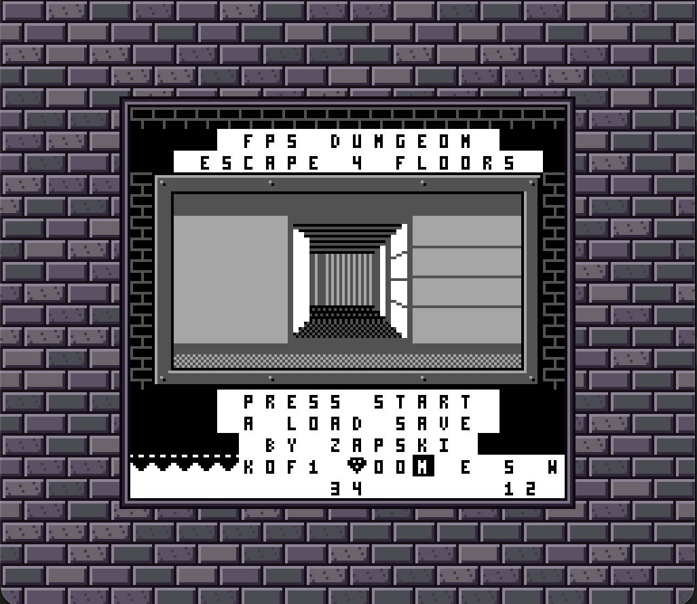

# GB-FPS-Dungeon — DMG raycaster crawler

A first-person Wolfenstein-style raycaster for the original Game Boy (DMG),
built in GBDK-2020 with hand-written assembly for the renderer. Four
randomly generated corridor-maze floors (one-way stairs down), keys and
doors, three pathfinding billboard enemy types (grunts, bats, brutes),
health, gold and map-scroll pickups that scale with distance, shooting
with an on-screen gun that lowers over items, an automap, three
battery-backed save slots, sound effects and a ~64 s background music
loop (B on the map mutes it), a title screen over a self-walking 3D maze,
a glide-in intro on each floor, game-over / win screens, a riveted frame
around the view, HUD compass, hearts and gold. The
3D view is a real 128×64 bitmap (64 rays, 2-px columns) drawn into tile
data and double-buffered across the two BG tile banks; HUD in the Window.

**How to play:** see the [Player Guide](docs/PLAYER_GUIDE.md) for controls,
items, enemies and saving. Download the ROM from the
[latest release](https://github.com/Zapskii/GB-FPS-Dungeon/releases/latest).

Build number: the two digits in the middle of the HUD's bottom row
(`BUILD` in `src/main.c`, now **34**) identify the current build; it goes
up by one every hand-off. Builds before 25 used one character (1–9, then
letters up to Y; the save build was briefly S).

Releases: **v1.0** = build 32 (2026-10-21), **v1.1** = build 33 (2026-10-22, title reads FPS DUNGEON), **v1.2** = build 34 (2026-11-01, Super Game Boy border, license), ROMs on the GitHub release page.

## Build

    make            # docker gbdk-dev -> dungeon.gb (32 KB)
    make clean

No local GBDK needed: the Makefile runs `/opt/gbdk/bin/lcc` inside the
`gbdk-dev` image.

    make border     # regenerate the SGB border (src/border_data.c)

The Super Game Boy border (stone bricks, 56 tiles, one palette) is drawn by
`tools/sgb/stone_art.py`, packed by
[GB-SGB-Tooling](https://github.com/Zapskii/GB-SGB-Tooling)'s `mkborder.py`
(expected at `~/GB-SGB-Tooling`, override with `SGBTOOL=`) and converted by
png2asset. The output is committed, so plain `make` doesn't need the tooling.
`main()` sends the border before `init_screen()` (the transfer overwrites
VRAM); `-Wm-ys` sets the header's SGB flag. Checked with GB-SGB-Tooling's
PyBoy byte test and Gearboy pixel check, and in mGBA; not yet on a real SGB.

## Controls

| Input | Action |
|---|---|
| D-pad up/down | walk forward/back |
| D-pad left/right | turn |
| B + left/right | strafe |
| A | shoot (hitscan at screen centre, ~4 shots/s) |
| Select | automap (pauses; B toggles music, Start saves to a slot, Select/A closes) |

Items are white and scale with distance (about 4, 8 and 16 px). Walk
over a key to take it, touch a **D** door (dark grey) with a key to open it,
walk to the down-arrow (stairs) to descend. Hearts restore one heart (left
lying if you're at full health), gems add to the gold count (HUD, next to
the floor number), and a scroll reveals the whole floor on the automap.
Grunts (dark blobs) walk the floor; bats (light wings, flying at eye
level) move twice as fast and die in one shot; brutes (a grunt drawn one
size bigger, floors 3–4) move at half speed and take three shots. Floor n
has n bats, 1 brute on floor 3 and 2 on floor 4, and grunts up to 8
enemies (5, 5, 4, 2). Enemies hurt on contact
(screen flashes inverted); one shot kills grunts on floors 1–2, two on
floors 3–4 (a hit enemy flashes white and is stunned briefly); at 0 hearts
the run ends on a GAME OVER screen (floor reached, kills, gold). Clear
floor 4 to escape: a win screen shows kills, seconds played (map time
excluded) and gold.
Start on either screen begins a fresh run. The title screen runs the
raycaster in attract mode: the camera walks a floor-1 maze on its own
(right-hand wall follower, `att_step()`) behind the title text. Each new
floor opens with a ~1.5 s glide into the spawn point while FLOOR n shows
(a walk away from the spawn, recorded into `ai_dist` and played back
reversed, so play starts exactly at the spawn); loading a save turns once
on the spot instead. Enemies, pickups and the clock wait during the intro;
`make PROFILE=1` skips it.
There are 3 save slots. Start on the map opens a slot picker ("SLOT 2
FLOOR 3" / "SLOT 3 EMPTY"): left/right choose, Start or A saves, B
cancels. With any slot used, the title and GAME OVER screens offer
**A LOAD SAVE**: the same picker over the used slots, and A or Start
puts you back where you saved. The picker starts on the slot last
loaded or saved.
HUD row 1, right: frames per second (views flipped per 60 VBlanks,
counted and written by the VBL ISR every second).

## Architecture

### Display path (bitmap in tile data, bank flip via LCDC.4)

The viewport is 16×8 BG tiles (indices 0–127, column-major) centred on a
black border. With LCDC.4 = 1 those indices read 0x8000–0x87FF (bank A),
with 0 they read 0x9000–0x97FF (bank B); indices 128+ are shared by both
modes, so the border, HUD (base 160) and sprites live there.

Per image the main loop: runs game logic once per elapsed VBlank (60 Hz
regardless of render rate, capped at 4 catch-up frames), renders into
`vbuf` (WRAM, 2 KB, laid out as the 128 tiles), waits for any pending flip,
`copy_vbuf()` streams it into the hidden bank, updates shadow OAM and sets
`flip_req`. The VBL ISR toggles LCDC.4 in the same VBlank as the OAM push
and also runs `hud_update()`, so the main loop never idles for VBlank. The
ISR must stay well inside VBlank (copy_vbuf's safety relies on it).

`copy_vbuf` polls STAT before every 2-byte burst. Once mode 0/1 is seen
VRAM stays open ≥ 80 T (rest of mode 0 + all of mode 2), and both stores
land within ~52 T, so it is safe whatever sprites do to mode 3 — unlike the
old interrupt-driven hblank streaming, whose 200–400 T handlers spilled
into mode 3. Verified on a physical DMG (2026-10-19). mGBA enforces
mode-3 blocking; gearboy does not.

### Renderer (`src/render.s`, assembly)

- 64 columns from the camera plane (`dir + plane·x`, set up per image by
  `setup_rays()` in C), so the DDA distance is already perpendicular: no
  fisheye correction. Amanatides & Woo DDA in 8.8; side distances in BC/DE.
- Adaptive casting: even columns (and column 63) are always cast; an odd
  column whose neighbours hit the same map cell from the same side copies
  their cell/type and averages their top/bot/zb (H is linear in screen x
  across a flat face, so this is exact up to rounding), else it is cast.
  Per column: `r_top`, `r_bot`, `r_zb`, `r_hits`, `r_wt` (type | side << 7);
  a separate colour pass then builds `r_clr`.
- Ray components are int8 at |dir| = 88.3 so the FOV corners fit; `rcp[]`
  is the matching one-cell step. Height = `ht[perp >> 3]` (2048/n, 2–64 px).
- Shading: x-facing walls colour 0, y-facing 1, doors 2. The first ray on a
  new map cell/face is one shade darker, which outlines blocks and corners
  (and darkens far walls, where every ray is a new cell).
- Fog: plain walls 3–6 cells away get the right pixel of each 2-px ray one
  shade darker (vertical-stripe dither, constant per row so the core fill
  stays one byte pair); beyond 6 cells both pixels. Edges and doors are
  never fogged. `r_clr` holds two colours per ray (bits 0–1 left, 2–3 right).
- Ceiling and floor come from a 64-row pattern table (`bg_tab`, generated by
  `tools/gen_bgtab.py`): ceiling dark grey near the viewer fading through
  line dithers to black at the horizon; floor black at the horizon through
  dots and checkers to light near the viewer. ~+4% render cost.
- Fill per tile column (4 rays): ceiling to the highest top, a constant
  all-wall core, floor from the lowest bottom, then read-modify-write only
  the ragged rows of each ray.
- Multiplication uses log/antilog tables (~230 T; ~1.5% error).
- `r_zb[64]` keeps the perpendicular distance per ray for sprite occlusion
  and fog.
- `=` walls: after the fill, three dark mortar rows at 1/4, 1/2 and 3/4 of
  the projected wall height (walls ≥ 8 px), so they read as brick and
  converge with perspective; `#` walls stay plain.

### Enemies and items (`src/ai.h` movement, `src/sprites.h` art)

8 entities moved on every 4th VBlank by `src/ai.h`: a BFS distance field
from the player's cell (rebuilt only when that cell changes or a door
opens, capped at 10 steps / 128 cells, ~1.3 KB RAM); each enemy walks
downhill along corridors, centring on the cross axis before advancing so
it never cuts corners (6 units a step, `ai_sp` = 12 for bats, 3 for
brutes). Farther than 10 steps they idle. `etype[]`: 0 grunt, 1 bat,
2 brute (`enemy_art` row 2 = the grunt tiers shifted one up, no new tiles).
Hit points `ehp[]` (1, 2 for grunts from floor 3, 3 for brutes); a non-lethal hit sets
`ehit[]` = 3 AI ticks of stun, drawn with OBP1 so the sprite flashes.
Contact damage under 0.78 cell with a 60-tick cooldown, driving `hp`
and the HUD hearts. `project()` is shared by billboards, item sprites and
`shoot()`; flashes are a BGP override counted down in the VBL handler.
Sprites are billboards in three distance tiers. Grunts: 8×16 far, 16×16
mid, 24×32 near (at 3 and 1.5 cells). Bats: ~4, 8 and 16 px wide, bottom at
screen y 68 with a ±2 px bob. Items: tiny, normal, 16 px (at 4 and 2
cells). `tools/gen_sprites.py` turns ASCII art into `src/sprites.h`
(29 OBJ pairs at 156–159 and 184–237); item big tiers are the normal
art doubled, tiny ones hand drawn or halved, and a pair that mirrors an
earlier one is stored once and drawn with X-flip (bit 0 of the tile byte
in the art lists). `draw_art()` places any `{w, h, tiles}` art by its
bottom centre; `shoot()` uses the art width as the hit half-width.
Projection is int32 forward/lateral (int16
overflows at 768×127), screen x via a shift-subtract divide, culled by
range and FOV, hidden when the wall at their column is nearer, feet placed
on the floor line. Up to 3 enemies are drawn nearest first, and every
billboard after the gun must fit a width budget of 7 sprites (DMG shows
the first 10 OBJ per line in OAM order; the gun takes 3), so a far one is
skipped whole instead of a near one losing columns. While an item is
drawn behind the gun, the gun slides down 1 px per tick to 16 px (back up
2 per tick): `gun_shift()` rewrites the idle art shifted inside its own 6
tiles (STAT-safe copies, 192 bytes per change), so rows past the bottom
drop off instead of spilling onto the frame. No recoil frame while
lowered (the screen still flashes). Computed after the copy from the
same camera the view was rendered with, and pushed in the flip VBlank.

### Levels (`src/mazegen.h`, generated on the cartridge)

Every floor is generated when it is entered, so each run gets new mazes.
The RNG is seeded from DIV and the frame counter when Start is pressed on
the title screen. `maze_generate()` (a C port of the old Python tool) builds
a 1-wide corridor maze (recursive backtracker on odd cells), carves a few
small rooms, knocks some dead ends through into loops (fewer rooms/loops on
later floors), then BFS from the start: key in the farthest dead end,
stairs in another far dead end whose only neighbour is a plain corridor
cell, which becomes the door (so the door seals exactly the stairs alcove
and no flood-fill validation is needed), grunts and bats ≥ 6 steps away,
2 health, 2 gold ≥ 4 steps, a map scroll ≥ 8, 15% of walls as `=`. It writes the char map
into `vbuf` and uses `seen[]` and the back of `vbuf` as scratch (both are
rewritten afterwards), so it costs no extra RAM.
Map grammar: `#` wall, `=` wall 2, `D` door, `K` key, `S` stairs, `H`
health, `G` gold, `M` map scroll, `P` start, `1`–`8` grunts, `B` bats,
`X` brutes. `load_level()` parses it into the
collision map, items, spawns, and camera; keys reset per floor, HP carries,
the floor-4 stairs show `win_screen()`, running out of hearts shows
`game_over()`; both start a fresh run on new mazes (GAME OVER can load
the save instead).

### Saves

The cart is MBC1+RAM+BATTERY with one 8 KB SRAM bank (`-Wm-yt0x03
-Wm-ya1` in the Makefile). Three slots, `SLOT_SIZE` (0xA00) apart from
0xA000. Each: the magic `DGN2`, the floor (shown by the picker), then
the variables listed in `save_vars[]` in order (camera, hp/keys/floor/
kills/gold/secs, enemies, items, stairs, `imap` with opened doors,
`seen`), about 2.2 KB. A save clears the magic first and writes it
last, so a power cut mid-save leaves no slot rather than a broken one.
Changing `save_vars[]` means bumping the magic. Hit flashes, the AI
field and the music position are not saved.

### Automap (Select)

`seen[1024]` marks cells the player has stood next to (3×3 on entering a
cell) plus the wall cell every ray hit (`r_hits[64]`, stored by render.s).
`show_map()` pauses the game, draws explored cells at 2×2 px into `vbuf`
(64×64 in the middle of the viewport: floor dark, wall light, door/key/
stairs white, unexplored black), copies and flips like a normal frame, and
shows the player as a white arrow sprite: the one direction needed is
copied from `arrow_tiles` (8 directions) into OBJ pair 154–155 each time.
Cleared on level load. While the map is up, the font is loaded over the
hidden sprite tiles (184–197) and "PRESS B" / "MUSIC ON|OFF" are drawn on
BG rows 13–14 with `banner()`; B toggles music, and on close
`frame_draw()` restores the bricks and the 14 sprite tiles are reloaded.

### Sound (`src/sfx.h`)

Fire-and-forget APU effects, one const table row each (NR10–14 for the
ch1 square/sweep, NR41–44 for ch4 noise); hardware length/envelope ends
them, no per-frame driver. SHOOT, HURT, KEY (also health), DOOR, STAIRS,
KILL, HIT. Effects
on the same channel cut each other off; ch2/ch3 belong to the music.
`sfx_init` also loads the triangle wave into wave RAM for the bass. Note:
gearboy's IO memory view shows stale NR51/NR52 values; its routed
`get_apu_status` tool reads them correctly.

### Music (`src/music.h`)

`music_tick()` runs from the VBL ISR (constant tempo whatever the render
rate): ch2 square melody, ch3 triangle bass, 8 frames per step. Tracker
layout: a note-name enum (`A4`, `Gs4`, `_` = no trigger), 16-step
patterns in `mus_lead[]` / `mus_bass[]` (bass via a `BASS()` macro), and
`mus_order[]` of {lead, bass} pairs: intro, A, A', B, C, A, B, A' in A
minor, 30 entries ≈ 64 s, ~600 bytes. `mus_period[]` holds ch3 periods
C2..C6; ch2 plays an octave higher for the same value, so lead notes read
`mus_period[n - 13]` (lead range C3..C6). Hardware envelope/length end
each note, no per-frame state beyond the step counter. To mute, the map
toggles NR51 bits for ch2+ch3 (`^= 0x66`); the song keeps advancing.

### Frame and gun

`src/frame.h`: a 1-tile riveted metal bezel around the viewport on a dark
brick backdrop (BG tiles 244–254), drawn by `frame_draw()` from
`draw_frame()`. `src/gun.h`: two-handed pistol, 3×2 sprites of 8×16 in OAM
slots 0–5 (tiles 130–141 idle, 142–153 recoil with a white flash via OBP1),
bottom edge on the viewport floor line; `gun_bob` advances while moving for
a ±2 px sway, recoil shows while `fire_cd > 9`. Billboards start at slot 6. Over an item the gun slides
down inside its own tiles (`gun_shift()`, see Enemies and items).
Art sources: `tools/gen_gun.py` (ASCII art → `src/gun.h` + preview PNG),
`tools/gen_frame_tiles.py` and `tools/preview_frame.py` for the frame.

### Title / game over / win screens

`text_screen()` (display off, BG map rewritten as centred white banners,
waits for Start) backs the title, `game_over()` and `win_screen()`. Text
uses the HUD font plus 13 extra letters at base 184 (`font_tiles`: YUCAPD
TILR GMV; M is 5 px wide so it doesn't read as N; O reuses digit 0).
Those tiles hold sprites during play, so the font is loaded for each text
screen and `draw_frame()` + `sprites_init()` restore frame and sprites
afterwards.

### HUD

Arriving on a floor shows a white " FLOOR n " strip across view tile
row 1 for 1.5 s (`banner_t`). The VBL ISR writes it into the BG map and
afterwards puts the view tile indices back; `text_screen()` cancels it.
L and R are copied from the font into tiles 238–239 at boot.

Window row 0: 5 hearts, `K n`, `F n`, gem + 2-digit gold (gem = BG tile
183), compass `N E S W` with the facing cardinal inverted. Row 1: the
build number and the FPS counter. Tiles at base 160 (`src/hud.h`, 23
tiles).

## Milestones (measured with the gearboy profiler/MCP)

| Milestone | Result |
|---|---|
| M1 streaming proof | 288 IRQs/window traced, capacity 576 vs 320 demand |
| M2b asm renderer | 421k T (C) → 96k T (asm) |
| M2c-1 perf | 59.5k T, 2-frame builds (30 fps greybox) |
| M2c-2 textures | 74.9k T, ~21 fps content |
| M3a HUD | compass/hearts/keys/floor |
| M3b enemies | billboards, chase AI, contact damage |
| M3c levels | 4 validated maps, keys/doors/stairs, death restart |
| Final display | VBlank-only, worst frame ~4.2k/4,560 T, ~15 fps content |
| Pixel renderer | 128×64 bitmap, 64 rays, STAT-polled copy, LCDC.4 flip; works on hardware |
| Gameplay 1 | shooting, key/stairs sprites, hurt/shot flashes (build 1) |
| Gameplay 2 | corridor-maze generator, start facing an open corridor (build 2) |
| Automap | Select map of explored cells + ray-seen walls (build 3) |
| Win screen | floor 4 → stats screen → new run (build 4) |
| Sound + AI | APU effects, BFS pathfinding enemies (build 5) |
| Display polish | frame, gun sprite, ceiling/floor gradients, wall fog (build 6) |
| Screens + FPS | title/game-over screens, FPS counter, VBL-ISR flip (builds 7–A) |
| Random mazes | on-cart generator per run, health pickups, 2-hit enemies (build C) |
| Speed | adaptive rays, log side distances, speed waves 1–4: 6.5 → ~10.75 fps (builds D–I) |
| Variety | bats, gold and map items, item size tiers, sprite generator (build L) |
| Sprite polish | gun lowers (M) then slides (P) over items; nearest-first, line-budgeted billboards (M) |
| Floor banner | "FLOOR n" across the view for 1.5 s on arrival (build R) |
| Brute | third enemy type: grunt art one size up, half speed, 3 HP, floors 3–4 (build T) |
| Music | ~64 s tracker-style loop on ch2/ch3 from the VBL ISR, B on the map toggles it (build U) |
| Speed 2 | halt-synced HBlank copy, generated wall cores, aligned ray tables, asm project(): ~10.75 → ~14.8 fps (build V) |
| Speed 3 | asm draw_art and ai_step, copy handover in mode 0, odd-column walk: ~15 fps (build Y) |
| Saves | battery SRAM (MBC1), one slot (25), then 3 slots with a picker (28) |
| Title | BY ZAPSKI (26), attract mode on a live view and floor intros (27) |

## Constraints & next steps

- Frame rate (build 8, gearboy, long corridor view): ~7 fps ≈ 8.6 frames
  per image. Profile: 64 × `cast_ray` ≈ 3.3k T each ≈ 3 frames (DDA steps
  ~1.8k, side-distance multiplies ~1.5k); copy ≈ 2 frames (near its STAT-
  polled limit, VBlank-only bursts would gain ~3%); fill + C ≈ 1.5 frames.
  Adaptive casting (build D), A/B in gearboy with a fixed seed and the
  same start view, images per 4 s: all 64 rays 26 (6.5 fps), adaptive 29
  (7.25 fps), +12%. A profiler sample showed ~1/3 of columns interpolated
  (34 casts vs 16 averaged). Build E: side distances as one log-domain
  lookup (`sd_lu`, log8 of the camera fraction once per image, `lrc[]`
  table; `tools/check_sd.py` checks it, worst error 3.7%) and one DDA
  loop per ray quadrant with no sign tests or step counter (~105–130 T
  per step, was ~250). Same A/B: 29 → 33 images per 4 s (7.25 → 8.25
  fps, +14%), image unchanged.
- Stage profile (build E, `make clean && make PROFILE=1`, fixed seed,
  start view, 64 images; zero `_prof_acc`..`_prof_imgs` with gearboy
  write_memory once in game, then read `prof_acc[]` = scanlines/stage):
  copy 2.28 frames, rays + colour + mortar 2.10, fill 1.87, sprite_update
  0.49, logic 0.32, seen[] 0.15, rest 0.14; total 7.34.
- Build F (speed wave 1): generated ceiling/floor writers (fill -9.8k T
  measured), asm udiv8/smul8 + foot_tab in project() (~5.5k T per visible
  object), BFS rebuild in asm without the 1 KB memset (open-room worst
  case ~271k -> ~76k T, simulated). Start view still 33 images / 4 s
  (~0.2 frames saved, under one image); the BFS gain shows as less
  stutter while enemies re-path, not at the static start view.
- Build G (speed wave 2): `copy_view` copies per tile column only rows
  [min top, max bot) of this image's rays united with the span last
  written to the same VRAM bank (`r_vh`); `view_reset()` after level load
  and the Select map. Profiler at the start view: copy 2.28 -> 2.04
  frames (-16.9k T; near side walls fill most rows here, so the gain
  grows in open views). Total 7.39 (build E) -> 6.96 frames per image.
  Checked in gearboy: no stale strips turning, at a wall, after the map.
- Build H (speed wave 3): unrolled ragged-edge patch (RTOP/RBOT
  macros), colour pass folded into ray_cs + a short fog loop, seen[]
  marked in dda_hx/dda_hy instead of the C loop. Byte-identical to G on
  3,300 random views in an SM83 interpreter. Profiler at the start view:
  render_asm -39.5k T, seen[] 0.15 -> 0.02; total 6.26 frames per image
  (~9.6 fps, HUD shows 09-10). Remaining per-label hot spots: wall-band
  loop f_cl ~28k T, mortar ~30k T, rd_step2 ~15k T.
- Build I (wave 4): wall band as an unrolled `.rept` block (fc_blk, 24 T
  per row), mortar only for '=' walls with one row address per column
  (mo_col), ray directions from per-image tables (r_dxs/r_dys), camera
  cell once per image, sd_lu/od_avg inlined. Byte-identical to H on 5,300
  random views. Profiler: render_asm 3.31 -> 2.63 frames (-47.8k T);
  total 5.58 frames per image (~10.75 fps, HUD 10-11).
- Build V (speed, HUD marker V): profiler at the start view 5.77 -> 4.05
  frames per image (~10.4 -> ~14.8 fps, HUD 14-15). Stage lines per
  image: render 406 -> 313, copy 316 -> 198, sprite_update 82 -> 51,
  gun + rest 19 -> 4.
  - Rays: page-aligned branch-free side-distance / DDA-step tables
    (`src/rtabs.s`, absolute at 0x7800, generated by
    `tools/gen_rtabs.py`; the Makefile fails if other ROM reaches them),
    DDA steps and camera state in HRAM, per-ray stores through one
    pointer (the per-ray arrays, imap and seen[] now live in render.s in
    a fixed order). Columns 2, 6 .. 58 are interpolated like the odd ones
    when k-2 and k+2 hit the same cell face: hit cells identical to
    casting on 25,600 sampled columns, heights within 1 px on 99.6%.
  - Copy: halt-synced HBlank bursts (STAT mode-0 request with IME = 0)
    chained line to line, sized by whether the line has sprites (shadow
    OAM band): 3/6 pairs from vbuf, 5/9 pairs for uniform wall cores,
    which fill no longer writes to vbuf (columns without '=' walls).
    Checked cycle by cycle in a scratch PPU model (mode 3 172-289 T):
    stores >= ~45 T before mode 3.
  - C: project() in asm (math.s, identical on 20,000 random points),
    gun_draw only when the sprite changes, sprite_update hides only the
    slots it used, cheaper enemy contact test.
  - Floors 1-4 played on a physical DMG (2026-10-20): clean, and the
    `make CHECK=1` build (re-reads the copied bank after every image,
    worst mismatch count at HUD row 1 left) stays 00 while turning,
    walking and using the map. That build runs at ~5 fps.
- Build Y (speed round 3, HUD marker Y): profiler at the start view
  4.08 -> 4.04 frames per image (~14.7 -> ~14.9 fps, HUD 14-15).
  Stage lines per image: logic 51 -> 47, render 319, copy 198 -> 196,
  sprite_update 51, rest 4. Three changes, each checked on its own:
  - `src/billboard.s`: `draw_art` in asm, writing `shadow_OAM` directly
    (same sdcccall(1) signature; the epilogue must pop SDCC's stack
    arguments). 3,336 -> 1,041 T for random art, 6,115 -> 1,816 T for
    a 3x2 billboard. OAM, return slot and SP identical on 4,008 random
    inputs; OAM identical on all 408 bench views.
  - `src/ai.h`: `ai_step` in inline asm (sdcccall(1), styled after
    `ai_bfs`), 982 -> 518 T per step, a full 8-enemy AI tick 8,090 ->
    4,378 T. Identical state (ex/ey, imap, BFS, flags) after every tick
    over 500 random mazes x 25 ticks.
  - `src/render.s`: a piece end in mode 0 hands straight to the next
    piece's burst instead of polling for the next mode 2 (modes 1-3
    still sync; a mode-3 handover cannot keep 40 T of store slack).
    copysim: 238 -> 233 lines per copy (-2,245 T), spans 231 -> 227;
    chain burst slack unchanged (>= 48 T). Less than the 15-25 lines
    the plan hoped for: the sync it replaces already bursts on the next
    line's mode 0.
  - `tools/sim/bench.py --cmp` compared a copied bank against vbuf,
    which build V no longer fully writes; it now compares the two copied
    banks (0/408 views differ, base vs Y).
  - `src/render.s` odd-column pass: k stays in DE for the pass, the
    per-column arrays are walked with one pointer (+64 per array)
    instead of address math per array, and k=63 is peeled out.
    15,170 -> 11,884 T for od_loop, -3,519 T/view over 60 bench views
    (every view faster; worst only -600). Gearboy start view, 64-image
    runs: render 319.0 -> 308.2 lines/image, total 622.0 -> ~617 lines
    (~15 fps).
  - Tried and reverted: S4 (ragged rows written once, merged via
    a coverage mask). -3,038 T/view over 400 random views but +6.3
    lines/image at the gearboy start view, where the near walls make
    almost every row ragged; the start view is the speed gate.
  - Checked in gearboy: start, turn, walk, shoot, map, floor 2, CHECK
    00 throughout. Confirmed on a physical DMG as part of build 28.
- ROM: ~30 KB of 32 KB used (~2.5 KB free at 0x6E2A-0x77FF plus 512 B
  after rtabs; the SGB border took ~4.5 KB in build 34),
  MBC1+RAM+BATTERY since build 25 with 8 KB SRAM (3 save slots use 7.5 KB). More floors or assets
  past 32 KB need ROM banking. WRAM: ~6.4 KB of 8 KB used.
- Build I tested OK in mGBA (2026-10-20, enforces mode-3 VRAM blocking).
  Still worth watching: an AI rebuild in an open room can take ~1 frame.
- Build L (enemy types, items, item size tiers) tested OK in mGBA and on
  a physical DMG (2026-10-20). Build M (lowered gun, sprite line budget):
  gun drop confirmed by the user. Build P (gun slides instead of jumping):
  confirmed working by the user (2026-10-20). Build U (music, B toggles
  it on the map) works on a physical DMG (2026-10-20).
- Free shared tiles: 240–243 (2 OBJ pairs or 4 BG tiles); 238–239 hold
  the banner's L and R.
- Decided: stairs stay one-way (no going back up a floor).
- Builds 25-28 (HUD shows the build number from 25): battery saves
  (25), BY ZAPSKI on the title (26), title attract mode and floor intros
  (27), 3 save slots with a picker (28). **Build 28 confirmed on a DMG
  (2026-10-20)**, which also covers build Y's speed changes.
- Build 29 (C logic speed, step 1): measured over 2,000 random bench
  views, the average image is ~627 lines and ~55% of views need 5 frames
  (the start view, 617, is a cheap one). `post_move()` rescans items only
  on a new cell or a hearts change (same-cell tick ~1,560 -> ~530 T);
  walk/strafe steps use `>> 3` instead of an int16 multiply by 16 (same
  values; `handle_input` ~5.5k -> ~4.0k T per walking tick). About 9-23
  lines per image (standing / walking). `tools/sim/pickup_test.py`
  checks pickups are unchanged.
- Build 30 (step 2, asm): `scan_enemies`/`scan_items` collect project()
  results into two `vis_t` arrays for sprite_update (18.4k -> 15.6k T;
  OAM identical on 408 bench views, 28 with billboards); `enemy_pass`
  runs the per-enemy contact/stun/speed/ai_step loop and enemy_tick
  applies contact damage once after it (26.1k -> 23.3k T with a BFS
  rebuild; identical state on 200 random A/B states with
  `tools/sim/enemy_ab.py`). About 12 lines per image. After a game over
  the rest of that tick's enemies no longer step on the new floor.
- Build 31 (cull): `project()`'s first check, a box of 10 cells around
  the camera, now uses a per-image radius `pj_r` (2..10 cells):
  render_asm tracks the highest wall top while filling and looks the
  radius up in `cull_r[]` (`tools/gen_cull.py`, from `ht`: a visible
  billboard is nearer than the wall at its column and inside the 90 deg
  FOV, so within sqrt(2) x the farthest wall; 1.45 plus 1/4 cell margin).
  1,000 bench views: sprite_update 18.8k -> 11.9k T, render +0.6k T, net
  ~-6.3k T (~14 lines); outputs and OAM identical on 1,020 views. A model
  stress test (300 random objects per view, 314k projections) culled none
  of the 1,836 visible ones; `tools/sim/cull_check.py` reruns it.
- Builds 29-31 confirmed on a physical DMG (2026-10-20).
- Rejected (2026-10-20, measured at build 31): casting the next image
  inside copy_view's halts. The copy idles only ~13.9k T per image over
  the bench views (~12.1k at the start view); slots after chained bursts
  average 54/78 T and the longest are 150-174 T, while pausing the copy
  for a chunk costs >= ~212 T (push/pop of the copy's registers, call/ret,
  resume jump). Ceiling ~30 lines if every idle T were free, ~0 in
  practice. A STAT-interrupt copy is worse (+210-245 lines: ~376 T of
  CPU per 3-4 bytes, none on sprite lines). Shrinking the view is out
  (owner's call). 20 fps (<= 462 lines) still needs ~115-135 lines cut;
  the copy's busy CPU is the biggest target (cu_chain 31.9k, cn_loop
  10.8k, cw_3l 9.7k, cw_chain 9.6k, cw_col 8.1k T per copy).
- Copy-speed candidates measured at build 31 (2026-10-20, copysim,
  `tools/sim/scratch_p0.py`; lines per copy, baseline 227.5 bench /
  193.4 start steady). Dropped: SP-sourced V bursts (`pop` 2 bytes):
  after the preload a pair costs pop + 2 stores = 36 T vs 40, and the
  SP setup per V piece (~52 T) leaves 21 T handover slack; every burst
  size tried breaks the 40 T rule. Periodic V rows as U: ~0, whole
  periodic V pieces are 0.2-0.3 per copy and splitting pieces costs
  ~1.7 lines per piece end. A per-line burst table from sprite counts:
  the lookup makes band halts up to 210 T late (mode-3 writes). Not
  picked (under 40 lines each): gun-only band 5V/8U when no billboard
  is visible + 4V/7U sync bursts (-12.6 / -10.9, simulated ok), leaner
  phase 1 (span union 4.6k + OAM band scan 3.5k T; ~-6..-10), faster
  `cw_next` (~508 T a piece end; ~-7..-12 realistic), unrolled VBlank
  copy (-3..-17, depends on the real VBL ISR length).
- Build 32 (C5b, column skip): copy_view's phase 1 keeps per VRAM bank
  and tile column the 16 ray bytes it last copied there (`c_key`, r_top,
  r_bot, r_wt, r_clr: all a column's pixels depend on) and skips a column
  whose bytes are unchanged; `view_reset()` invalidates the keys. Exact:
  `bench.py --cmp` 0/408 random and 0/1083 `--motion` views (44.6% of
  columns skipped); CHECK 00 in gearboy and on a DMG. Gearboy profile,
  lines per image: still start view copy ~199 -> 68, total ~575 -> 433;
  holding Right copy 217.6 -> 153.0, total 584.4 -> 517.3. copysim per
  copy: walk 64/image 214 -> 179; a view sharing no column costs ~+19
  (key compare ~8-9k T). A copy where every column is skipped ends
  right after phase 1. Next: a matched column doesn't need fill_col
  either (render-side saving, fill/cast plan).
- Ideas not done: two-colour wall textures, a ranged enemy or floor-4 boss, difficulty and
  a score screen, footstep/alert sounds.
- Test display-path changes in **mGBA or hardware** — gearboy does not
  enforce mode-3 VRAM blocking.

## Gotchas (hard-won)

- sdasgb has no `ld hl,(nn)` / `ld (nn),hl` and no `neg` (use `cpl/inc`).
  Use HRAM byte pairs via `ldh` for 16-bit pointers in ISRs.
- An unclosed `.rept` in sdasgb silently stops emitting code (the link
  then fails on undefined symbols much later). Close it with `.endm`
  (`.endr` is not accepted).
- `__at(addr)` HRAM variables get mangled into undefined hash symbols by
  SDCC; use pointer-cast macros like GBDK's register map.
- SDCC: `uint8_t` loop counters against 1024 never terminate (warning 94);
  statics must be declared before use; ternaries and combined conditions
  can trigger "conditional flow changed by optimizer" miscompiles — use
  plain nested if/else in hot C.
- SDCC "warning 158: overflow in implicit constant conversion" on the
  FLOOR banner's `HUD_DIGIT(0)` writes in `hud_update()` is spurious (the
  value is 160+n < 256).
- Symbol addresses for debugging are in `dungeon.noi` (globals only;
  statics such as `ex`/`ey`/`ealive` sit just after `cam_x`/`cam_a`).
- Instruction cost discipline: T-cycles are 4× M-cycles; `ld (de),a` +
  `inc de` is 16 T, so a 320-byte copy is ~7,700 T, not ~2,000.

## License

Free for non-commercial use under the [PolyForm Noncommercial License 1.0.0](LICENSE):
play it, share it, study and modify the source, but keep the
`Required Notice:` copyright line (credit) with any copy. Selling the game, or
using its code in anything sold, needs a separate commercial license; contact
[Zapskii](https://github.com/Zapskii).

`src/sgb_border.c` and `src/sgb_border.h` come from
[GB-SGB-Tooling](https://github.com/Zapskii/GB-SGB-Tooling), derived from
GBDK-2020's `sgb_border` example. They stay under GPLv2
([licenses/GPL-2.0.txt](licenses/GPL-2.0.txt)) with the GBDK linking exception
([licenses/GBDK-LINKING-EXCEPTION.txt](licenses/GBDK-LINKING-EXCEPTION.txt)),
which lets the ROM built from them ship under the terms above.
